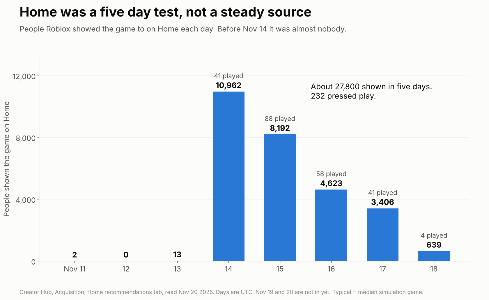
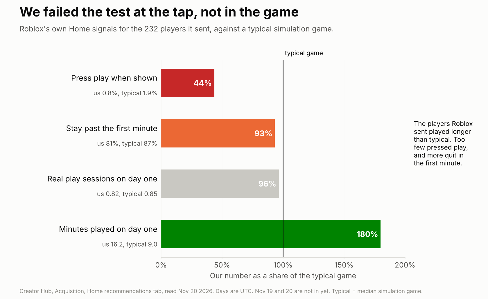
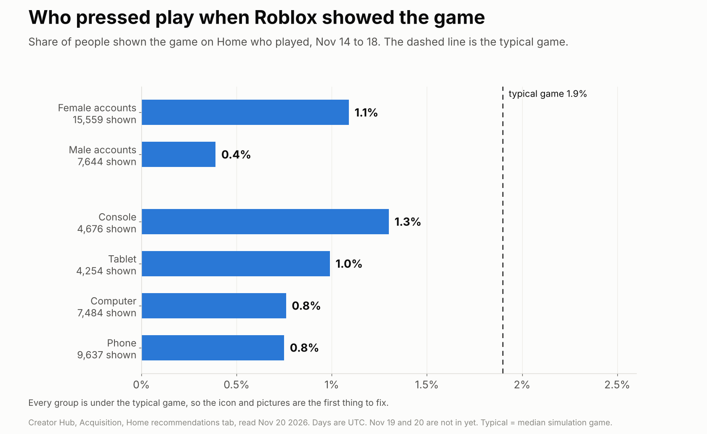

# Home recommendations: can they come back?

Growth, Nov 20 2026. Numbers are from Creator Hub (Acquisition, Home recommendations tab). Days are UTC. Nov 19 and 20 are not in the data yet.

## Verdict

**It is not over, but they will not come back by themselves in the next week or two.** The earliest realistic window is the first week of December, and only if the icon and pictures get more people to press play before then.

Update Nov 20 11:40 UTC: Derek dropped the freeze. The new start (issue #5533) ships now and a Device improvements event runs Sat Nov 21 3 PM ET, so there are two triggers before Christmas: Saturday's event and the Dec 1 update.

The drop from 11,000 to 637 was not Roblox taking away something we had. Home had never shown the game before Nov 14. On Nov 14 Roblox started a test, showed the game to about 27,800 people over five days, and wound the test down when too few of them pressed play.

## What Roblox says drives Home

From Roblox's own discovery page (create.roblox.com/docs/discovery) and the Home recommendations tab:

- It scores a game only on players who joined from Home itself. Players who first came from ads are not counted in the ranking. So the ads did not poison Home. Roblox does say ads and other sources help a game get considered sooner, which fits the test starting three days after the ad traffic jumped.
- The signals are: how many people press play when shown the game, how many quit in the first minute and in the first three minutes (both count against a game), minutes played, days played, real play sessions, playing with friends and Robux spent, each measured on day 1, days 2 to 7 and days 8 to 28.
- A game gets a test burst ("explore"). If that group plays well, Roblox widens it ("expand"). Roblox gives one example of what starts a burst: a content update.
- Roblox publishes no timetable for recovery and no rule that shuts a game out for good. It says quality is re-rated with every update. Games it has marked down get a banner in Creator Hub. We have no such banner.

## How we did in the test

| Signal | Us | Typical simulation game | Top 10% |
|---|---|---|---|
| Press play when shown | 0.8% (232 of about 27,800) | 1.9% | 4.4% |
| Quit in the first minute | 19% | 13% | |
| Quit between 1 and 3 minutes | 23% | 19% | |
| Minutes played on day one | 16.2 | 9.0 | 18 |
| Real play sessions on day one | 0.82 | 0.85 | 1.1 |
| Robux spent on day one | 0 | | |

Two things lost the test and one thing is good news.

1. **Too few pressed play.** Under half the typical rate. This is the icon, the pictures and the name, not the game. Every group was under typical: female accounts 1.1%, male accounts 0.4%, console 1.3%, tablet 1.0%, computer and phone 0.8%.
2. **More quit in the first minute** (19% against 13%).
3. **The ones who stayed played longer than typical**, 16 minutes on day one against 9, close to the top 10%. About 8% of them came back the next day against 3.5% for ad players (only 232 players, so that is rough). Home sends us better players than ads do.

Days 2 to 7 for these players are not scored yet. They show up around Nov 22 to 25.

## Which pictures Home showed (added Nov 20 12:00 UTC)

From Creator Hub, Thumbnails, Home Page, Nov 14 to 20. "Real plays" here is Roblox's qualified plays, a stricter count than the 232 who pressed play.

| Picture | People shown | Real plays | Rate | Minutes a session |
|---|---|---|---|---|
| BACK PACK! | 7,999 | 56 | 0.70% | 14.2 |
| SECRET CATS! | 4,336 | 21 | 0.48% | 14.8 |
| CAT TRAITS! | 4,434 | 17 | 0.38% | 21.4 |
| BOOM! (cannon) | 894 | 4 | 0.45% | 23.5 |
| CATS WORK! (off now) | 795 | 3 | 0.38% | 22.3 |
| CATCH CUTE CATS (cafe full of cats) | 85 | 1 | too few | |
| All | 25,559 | 114 | 0.45% | 15.1 |

Every picture that names a feature failed, and none of them shows the first minute of play.

Update Nov 20 12:31 UTC: Derek OK'd the new set and it is live. Active on Home now: BACK PACK plus four new pictures (one catch with the net, I GOT IT, a Gold cat at the bowl, the cafe before and after). SECRET CATS, CAT TRAITS, the old cafe picture and BOOM are off (Roblox allows 5 active). The icon is now K2, the orange Excalipurr face. First fair read of the new pictures is Nov 27 or later, once Home shows the game again.

## Why it will not fix itself

Roblox only scores players it sends from Home, and it is now sending about 4 a day. With that few, our score cannot move, good or bad, until Roblox runs another burst. Fixing the game alone does not raise the Home score. It makes us ready for the next burst.

## What brings it back, in order

1. **New icon and pictures before the next burst.** This is the biggest lever and the only one that moves the press play rate. Roblox lets a game upload several pictures and shows each player the one that suits them. Aim for 1.9% or better, so more than double.
2. **First minute.** Plan A fix 1 (a cat in the first 20 seconds), live since Nov 20, goes straight at the first minute quits.
3. **Coming back on days 2 to 7.** Plan A fix 3 (welcome back moment, daily gifts, milestones) feeds the days played signal.
4. **A reason for Roblox to test again.** The Christmas event on Dec 1 is the natural one. A small steady flow of players from any source keeps the game in consideration.

## When

- Now to Nov 30: expect Home to stay near zero. That is normal for this state and not a new problem.
- Dec 1 to 7: the first real chance, with Christmas live and new pictures up. A second burst would look like a few thousand people shown per day again.
- Good sign: more than 500 people shown per day for three days running with the press play rate over 1.5%.
- If there is no new burst by mid December even with new pictures and the Christmas update, the answer is another round on the icon, pictures and first minute, not giving up on Home. Derek, Nov 20: Home is the only way the game runs without losing money on ads, so Home is never written off.

## What I am not sure of

- Roblox does not say how often it re-tests a game. "After a content update" comes from one example on its page, not a promise.
- 232 players is a small group. The minutes and next day numbers could shift.
- Nov 19 and 20 are not in yet. I will add them to the Nov 21 read.
- An earlier line in the go or no-go review said Roblox pulled the game from Home. That was too strong. It was a first test that ended.

## Sources

- Roblox discovery page: https://create.roblox.com/docs/discovery
- Roblox staff post on Home tests, Nov 2025: https://devforum.roblox.com/t/tests-continuing-to-improve-the-%E2%80%98recommended-for-you%E2%80%99-algorithm/4067565
- Roblox staff post on play rate benchmarks: https://devforum.roblox.com/t/analytics-recommendations-qualified-play-through-rate-and-similar-experiences-benchmarks/3075185
- Developer report that ad traffic lowers engagement numbers (not confirmed by Roblox): https://devforum.roblox.com/t/sponsored-ads-traffic-degrades-the-engagement-metrics-used-for-discovery-causing-paid-acquisition-to-harm-organic-ranking/4838351
